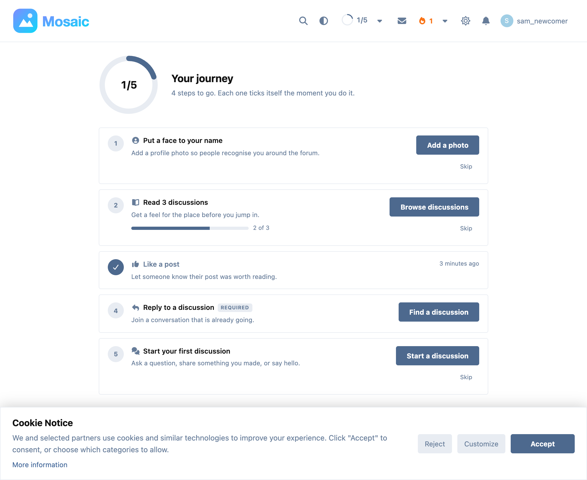
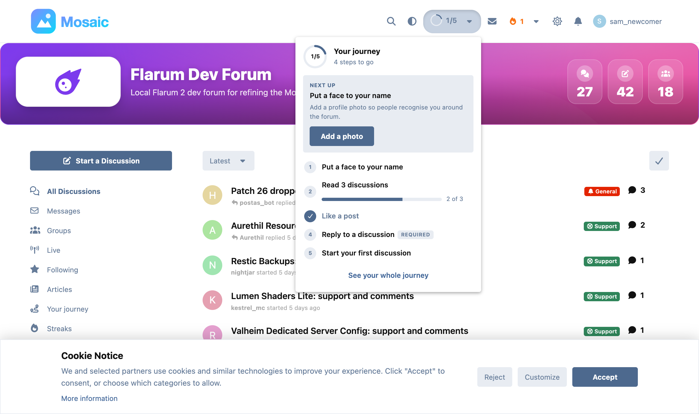
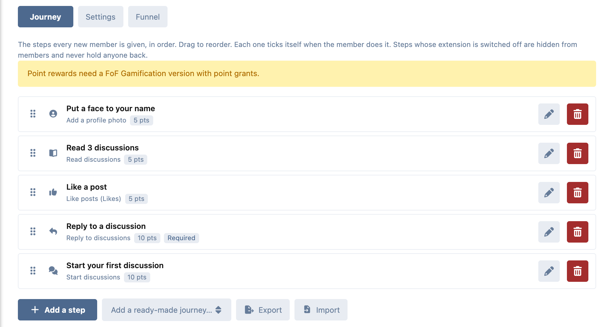
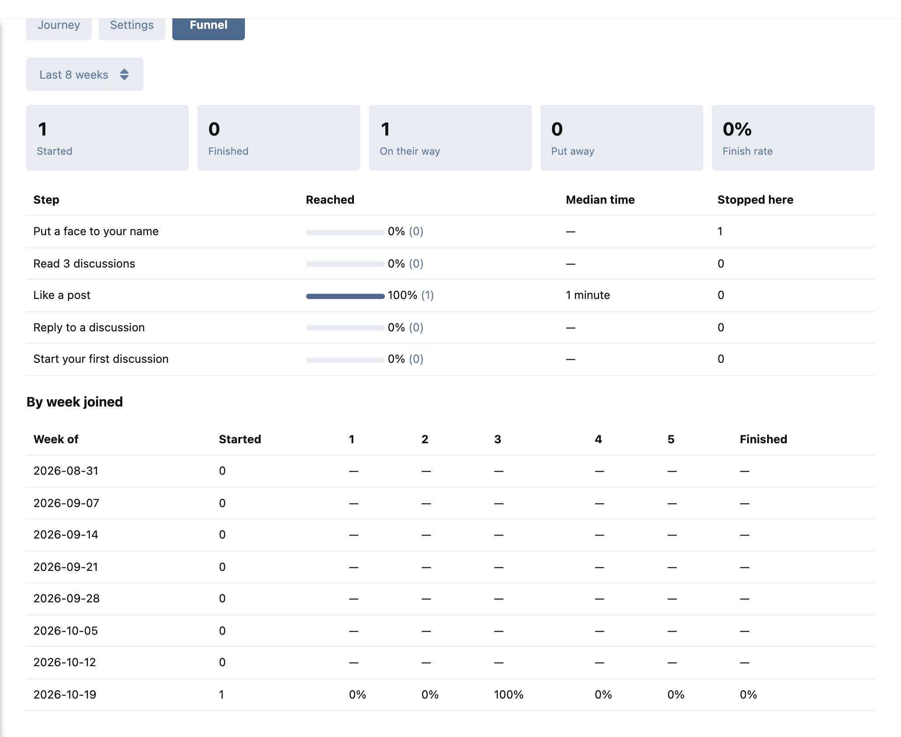

# Onramp

**Onboarding quests that turn new sign-ups into regulars.** A short journey of steps for every new member, each of which ticks itself the moment they do it. Steps pay out in [FoF Badges](https://github.com/FriendsOfFlarum/badges) badges and [FoF Gamification](https://github.com/FriendsOfFlarum/gamification) points, and a funnel shows you where newcomers stop.

Free and open source (MIT), for Flarum 2.



## What members get

- **A journey that does itself.** "Put a face to your name", "Read 3 discussions", "Reply to a discussion"… Nothing to tick by hand: each step completes as the member does it, anywhere on the forum.
- **Always one tap away.** A ring in the header shows their progress; open it (or press **J**) for the next step and the button that gets it done. The `/onramp` page shows every step, what it pays, and how far along they are ("2 of 3 read").
- **Told on the spot.** A toast on whatever page they are on, the moment a step completes. Steps completed by someone else (a like received, an answer marked best) arrive as an alert.
- **Their choice.** Optional steps can be skipped (and the skip undone); the whole journey can be put away and brought back.
- **Reminders** on day 3, 7 and 14 by alert and email, each switchable off like any other notification.

## What admins get

- **A step editor** with drag-to-reorder, three ready-made journeys, and JSON import/export to move a journey between forums.
- **21 step types**, each shown only when the extension behind it is enabled:

  | | |
  |---|---|
  | Core | profile photo, confirm email, read discussions, start discussions, reply (either optionally in one tag), visit a page |
  | Bundled | display name (Nicknames), mention someone (Mentions), give or receive likes (Likes), follow discussions (Subscriptions), private messages (Messages) |
  | FoF | bio (User Bio), react (Reactions), upvote (Gamification), best answer (Best Answer), follow tags (Follow Tags), vote in polls (Polls), upload files (Upload), private discussions (Byobu) |
  | Ernest's | keep a streak (Cadence) |

- **Rewards** per step and for finishing: points, a badge, and a group for graduates.
- **Two FoF Badges triggers** of Onramp's own, "Onramp steps completed" and "Finished their Onramp journey", for building a badge ladder in FoF Badges' editor.
- **The funnel:** journeys started, finished, open and put away; how many reached each step and the median time it took; which step most of the unfinished are stuck on; a bottleneck warning; and the same per weekly cohort.
- **A staff tab** on every member's profile (moderators see it, admins can start, reset, put away, bring back, or tick a step by hand).
- **Journeys for members who joined before Onramp**, for whoever joined in the last N days, with everything they already did ticked straight away. It runs in batches, so no request times out.







## How it behaves

- **Counted, not tallied.** A step's progress is counted from the forum's own records; events only say "look again". So a journey started today already shows what the member did last month, and nothing can be counted twice.
- **Paid once, ever.** A step is claimed by a conditional write; only the request that claims it pays. Deleting the post that completed a step does not untick it, and resetting a journey does not pay again.
- **Costs nothing for everyone else.** Guests, graduates and members who never had a journey add **zero** queries to any page. A member mid-journey adds three, on their own user only. (Measured in `tests/integration/api/CostTest.php`.)
- **Never breaks a page.** Steps are evaluated after the request has done its work, and anything that goes wrong in Onramp is logged, never shown.

## Installation

```bash
composer require ernestdefoe/onramp
php flarum migrate
php flarum cache:clear
```

Enable **Onramp** in the admin panel. A five-step journey is ready straight away. New members get one when they sign up; to give one to members who joined recently, use **Settings → Members who joined before Onramp**, or:

```bash
php flarum onramp:start --days=30
```

Reminders and tidying up run from Flarum's scheduler (`onramp:remind`, hourly). Make sure the [scheduler](https://docs.flarum.org/2.x/console#schedulerun) is set up.

### Rewards

- **Badges** need [FoF Badges](https://github.com/FriendsOfFlarum/badges).
- **Points** need [FoF Gamification](https://github.com/FriendsOfFlarum/gamification) with its point-grants API ([FriendsOfFlarum/gamification#180](https://github.com/FriendsOfFlarum/gamification/pull/180)). Until your forum runs a version with it, the points fields are switched off and say why.

## For developers

Add a step type from your own extension:

```php
// extend.php
(new Flarum\Extend\Conditional())
    ->whenExtensionEnabled('ernestdefoe-onramp', fn () => [
        (new \ErnestDefoe\Onramp\Extend\StepTypes())->add(JoinedAGroup::class),
    ]),
```

`JoinedAGroup` extends `ErnestDefoe\Onramp\StepType\StepType`: a key (namespace it, `myext.joined`), an icon, the events after which the count may have moved, and how to count it. Give it wording under `ernestdefoe-onramp.lib.types.<key>.title` / `.description` / `.button` in your locale file.

Listen for `ErnestDefoe\Onramp\Event\StepCompleted` and `ErnestDefoe\Onramp\Event\Graduated`, each dispatched once per member (and step), ever.

## Links

- [Source](https://github.com/ernestdefoe/onramp) · [Issues](https://github.com/ernestdefoe/onramp/issues)
- ☕ If you like the things I have built, consider [buying me a coffee](https://buymeacoffee.com/ernestdefoe).
